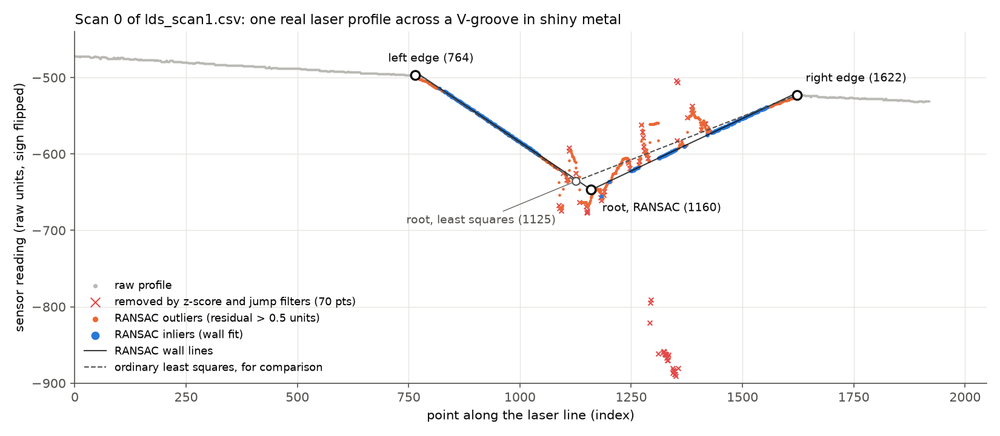
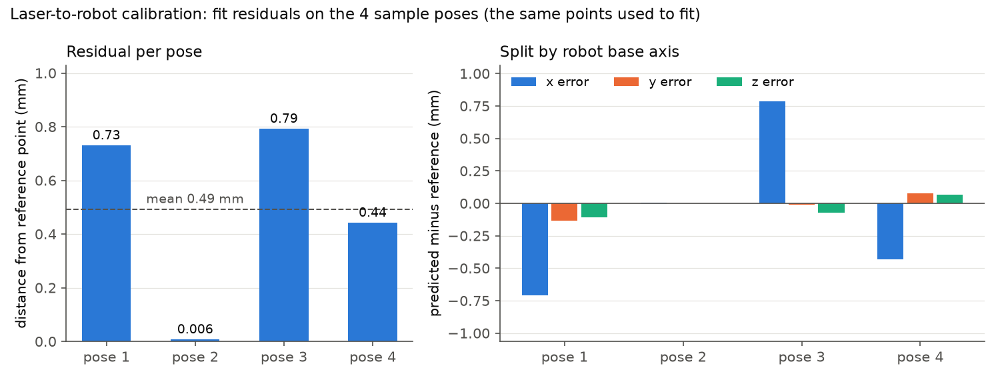
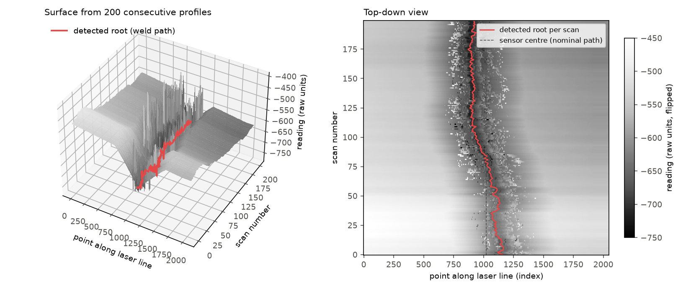

# Laser seam analysis for robotic welding

Python prototypes that find weld-joint features in real laser line-scan profiles of shiny metal, calibrate the laser to a robot's tool centre point, and turn a run of scans into a weld path.



*Scan 0 of `Sample_Data/lds_scan1.csv`. On polished metal the laser reflects around inside the groove, so the sensor reports points that aren't on the surface: the clusters above the right wall and the cluster more than 200 units below the root. Fitting each wall with RANSAC and intersecting the two lines puts the root at index 1160; ordinary least squares on the same points is dragged by the reflections to 1125.*

The data is the interesting part. A laser line sensor on a welding robot returns 2,048 distance readings across the joint, and on bright metal those readings are full of specular reflections and dropouts (10.5% of readings in `lds_scan1.csv` are missing). Features have to be found despite that, then mapped into the robot's frame. On the four sample calibration poses, the fitted laser-to-robot transform puts the reference point within 0.49 mm on average.

## Results

All numbers come from the code and sample data in this repo, run on an Apple M6 (12 cores, 32 GB, CPU only).

| What | Result | How it was measured |
|---|---|---|
| Laser-to-robot calibration fit | mean 0.49 mm, max 0.79 mm | `laser_robot_calibration.py`: distance from each predicted point to the reference point, on the same 4 poses used to fit the 6 parameters |
| Repeat reading, second calibration session | 0.65 mm | `sensor_robot_transform.py` maps a fresh reading at one of that session's poses to (1519.91, −415.15, 203.75); the reference point measured for that session was (1519.65, −415.29, 203.17) |
| Cleaning | removes 5.1% of valid points per scan on average (max 8.7%) | z-score and jump filters in `scan_analysis.clean_v_groove`, over all 200 scans of `lds_scan1.csv` |
| RANSAC root vs least-squares root | differ by 16 indices on average (max 49) | `scan_analysis.calculate_groove_lines` on all 200 scans, numpy seeded at 0 |
| Seam position across the weld | drifts from index 1160 on the first scan to 920 on the last (range 872–1166) | `weld_path_3D.py`, numpy seeded at 0 |

There's no ground truth for the profile features, so the RANSAC row shows that the choice of fit matters, not that RANSAC is right to within a known error.

### Calibration



Most of the residual is along the robot's x axis. Pose 2 fits almost exactly (0.006 mm) because the objective is a sum of distances, which tends to pin some points to zero error; that's not a sign of extra accuracy at that pose. These are fit residuals on 4 points that all share one tool orientation, so they say how consistent the measurements are, not how the calibration generalises (see the Euler-angle limitation below).

### Weld path



`weld_path_3D.py` runs cleaning and the RANSAC root fit on each of the 200 consecutive profiles and draws the result on the surface. The joint isn't parallel to the scan direction, so the root drifts by about 240 points across the run. Scan-to-scan jumps have a median of 8 points but reach 43, and 20 of the 199 jumps are larger than 20 points.

### Keypoint CNN

`CNN_feature_extraction.py` trains a small 1D CNN to predict the left edge, root and right edge indices. On its 20 test scans:

| Method | Mean absolute error (indices) |
|---|---|
| Predict the training mean | 93.25 |
| CNN (`Sample_Models/weights_4.pth`) | 18.50 |
| Copy the label of the nearest training scan | 7.23 |
| Interpolate between neighbouring training scans | 5.59 |

The CNN loses to copying a neighbour's label, and the evaluation can't show more than that (see limitations).

## Run it

```bash
uv sync
uv run python laser_robot_calibration.py      # prints the sensor frame and fit error, 3 s
uv run python sensor_robot_transform.py       # prints one laser point in robot coordinates, <1 s
MPLBACKEND=Agg uv run python weld_path_3D.py  # writes Results/weld_path_3D.png and _2D.png, 14 s
```

Timings are wall-clock on the M6 after `uv sync`. `3D_surface_modelling.py`, `generate_synthetic_data.py` and `WeldSeamTracking.py` run the same way and write to `Results/` (under 2 s, under 2 s and 8 s; the last sleeps on purpose). Without `MPLBACKEND=Agg` they also open a window.

`scan_analysis.py`, `data_preprocessing.py` and `CNN_feature_extraction.py` wait for a click on each figure (`plt.waitforbuttonpress`), so run them with a display. Headless they hang. `track_flow.py` reads from webcam 0.

The figures in `assets/` were drawn with my own plotting code around the repo's functions (`clean_v_groove`, `extract_lines`, `calculate_groove_lines`, `get_robot_frame_coord`, `detect_seam_features`), on the sample data, with numpy seeded at 0. Everything in `Results/` is written by the scripts themselves.

## How it works

The data. `lds_scan1.csv` is 200 consecutive profiles along one V-groove, 2,048 points each; `lds_scan2.csv` is 100 profiles of a second joint, with 52% dropouts. Values are raw sensor units and a 0 means no return. The scripts flip the sign so the groove points down and treat 0 as missing.

Cleaning. Each profile goes through a z-score filter (points beyond 2.2 standard deviations of the whole profile), a jump filter (points more than 3 units from their neighbour) and linear interpolation over the gaps. They're blunt: they catch the far-off reflections and leave the near-surface ones to the line fit. `data_preprocessing.py` is where I tried the alternatives (MAD z-score, local outlier factor, DBSCAN, Hampel, total-variation denoising, LOWESS) and compared them by eye on one profile.

Features. The edges are where the gradient of a Savitzky–Golay-smoothed profile (window 51, order 2) first drops below −0.2 from the left and rises above 0.2 from the right. For the root I fit a line to each wall (from its edge, half the groove width inwards) with scikit-learn's `RANSACRegressor` (residual threshold 0.5 units, 100 trials) and intersect the two lines. Reflections pile up near the root, so the lowest point is often a reflection, and least squares gets pulled towards them; two RANSAC lines and their intersection avoid both.

Calibration. The sensor's pose on the robot is six numbers (x, y, z and rotations w, p, r about x, y, z, applied as Rz·Ry·Rx). A laser reading becomes a robot-base point by rotating the sensor offset with the tool orientation and rotating the laser point with the combined orientation. To fit the six numbers I measure one fixed reference point with the laser from several tool positions, then minimise the summed distance between the predicted points and the reference with finite-difference gradient descent (learning rate 0.01, 30,000 steps). On these 4 poses it runs in about 3 seconds.

Weld path. For each scan the root index is compared with the sensor centre to give an offset; stacking the scans gives the path on the surface. An exponential moving average of the offsets is computed but not yet used in the plot.

The rest. `WeldSeamTracking.py` simulates a torch following a seam found in noisy synthetic profiles. `track_flow.py` estimates surface motion between camera frames from matched ORB features. `generate_synthetic_data.py` makes ideal butt and V-groove profiles with Gaussian noise. `3D_surface_modelling.py` plots a scan matrix as a surface.

## How this evolved

This started in 2025 as separate prototypes written while working with a laser line sensor and an industrial camera for robotic welding, committed in September 2025 as one 2,104-line commit. That version read frames from the camera's SDK in `track_flow.py` and held calibration data from several sessions. Between December 2025 and January 2026 I swapped the camera for a webcam, rebuilt the seam-tracking simulation with live plotting and mm units, gave the synthetic profiles realistic joint geometry, added the 3D weld path and saved figures to `Results/`. Each script still carries its own copy of the loading, cleaning and RANSAC code. This round changed no code: I added the dependency files, re-ran everything to regenerate the figures, and measured the baselines above.

## Limitations and next steps

What the current code doesn't do yet, measured:

- Calibration orientation: Euler angles are added rather than composed (`laser_robot_calibration.py:44`). That's exact at the orientation it was fitted at, and all 4 sample poses share one, so the data can't reveal it. It costs 0.30 mm at tool orientation (0, 0, 0) and 31.6 mm at (180, 0, 0).
- Default path in `scan_analysis.py`: It runs the edge finder on the unsmoothed profile and finds the plate tops (0 and 1910) instead of the groove edges (764 and 1622). The working path, used for the figures here, smooths first.
- No ground truth: Profiles are in raw sensor units, so feature accuracy isn't measured in mm. RANSAC isn't seeded, so the root moves between runs (median spread 4 indices, worst 33).
- CNN: Its labels are the RANSAC output and its test scans sit between near-identical training scans, so it can't show more than imitation. It doesn't beat copying the nearest scan's label.
- Seam tracking and camera flow: The tracking simulation never closes the loop, so its torch path is a random walk. `track_flow.py` can't tell left from right (`arctan` instead of `arctan2`).

Next, in order:
1. one package with a headless pipeline and tests;
2. calibration with composed rotations, `scipy.optimize.least_squares` and poses at several orientations, checked by recovering a known sensor frame from synthetic data;
3. synthetic profiles with modelled reflections and known keypoints, so feature error can be measured;
4. a learned model trained on synthetic profiles and tested on a held-out block of real scans against these baselines.

## Credits

- The sample scans and calibration poses are real measurements from a laser line sensor on a welding robot, released with the code under the MIT licence.
- RANSAC: M. A. Fischler and R. C. Bolles, "Random sample consensus", Communications of the ACM, 1981. ORB: E. Rublee et al., ICCV 2011. Savitzky–Golay filter: A. Savitzky and M. J. E. Golay, Analytical Chemistry, 1964.
- Libraries: NumPy, pandas, SciPy, scikit-learn, scikit-image, statsmodels and PyTorch (BSD-3-Clause), OpenCV (Apache-2.0), Matplotlib (Matplotlib licence, PSF-based).

Code: MIT, see `LICENSE`.
